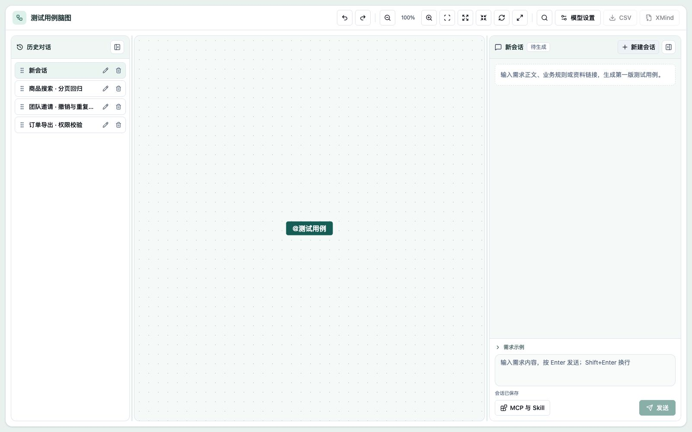
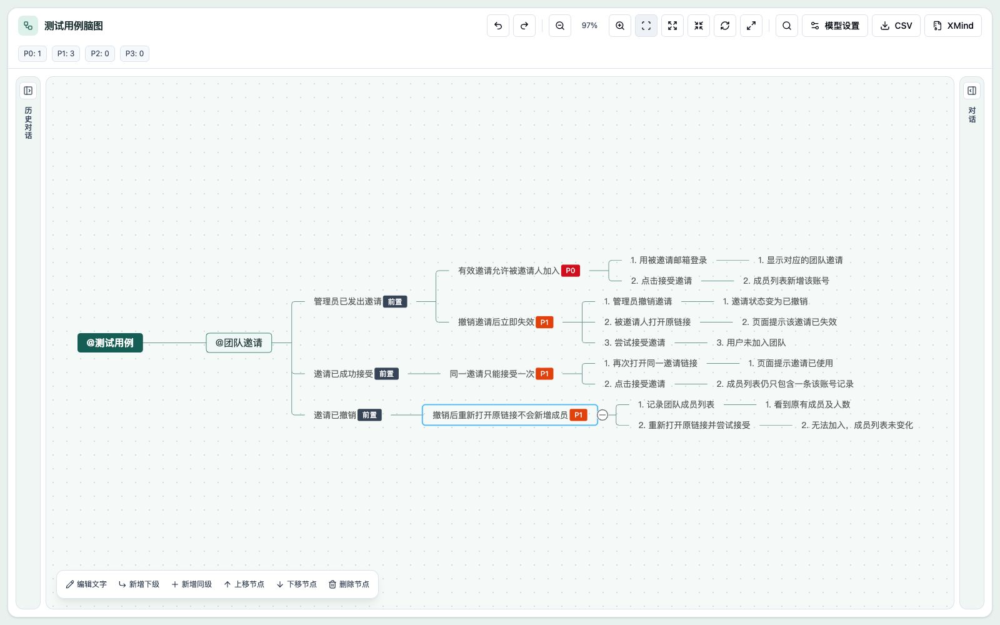
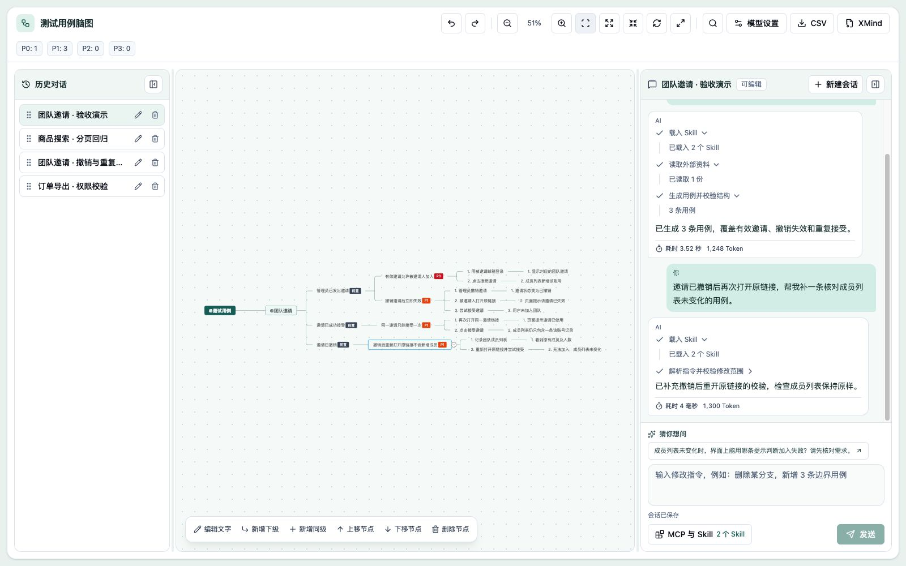
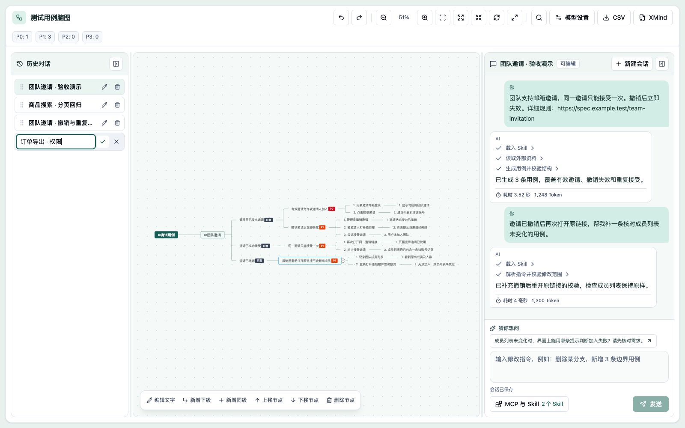
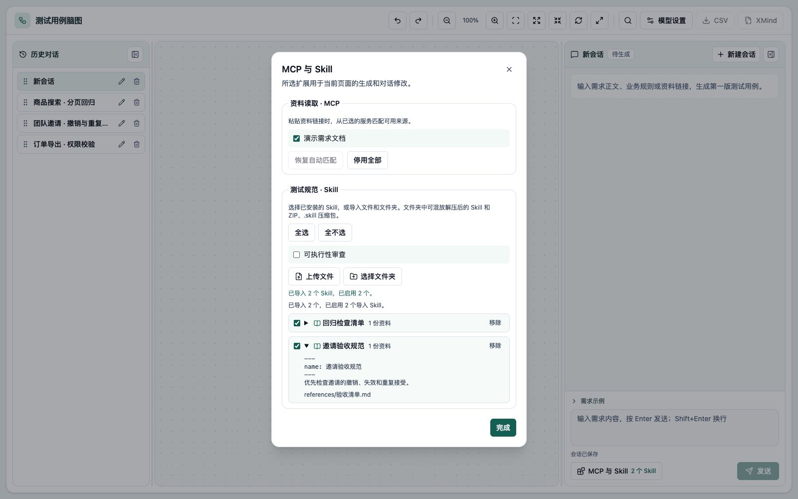
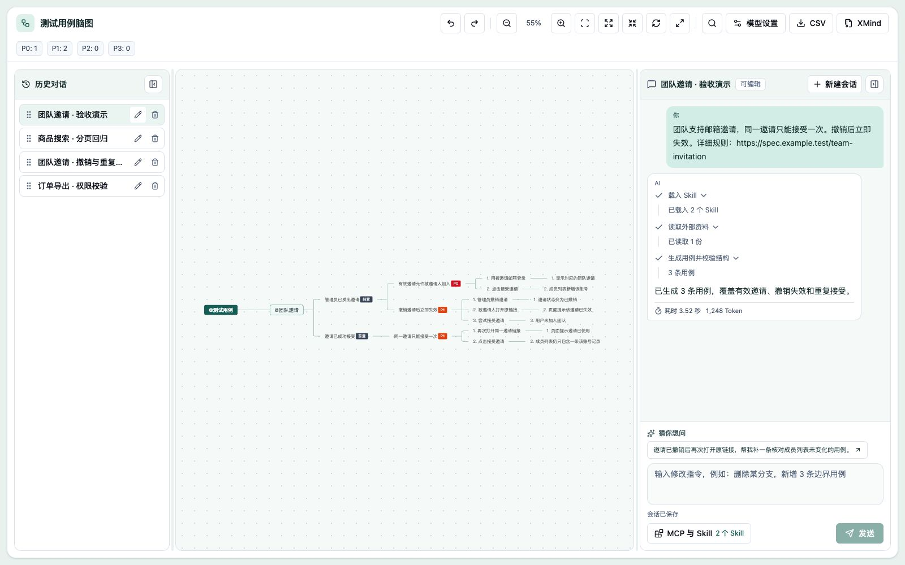
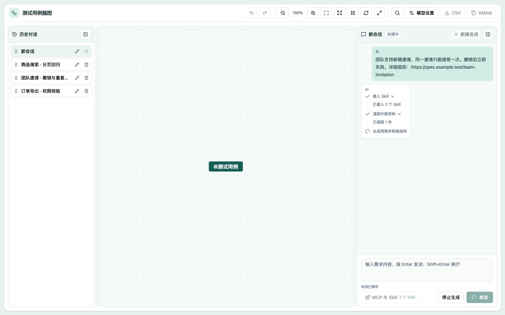
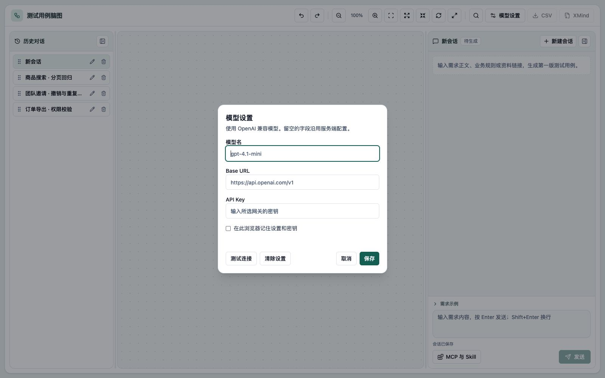
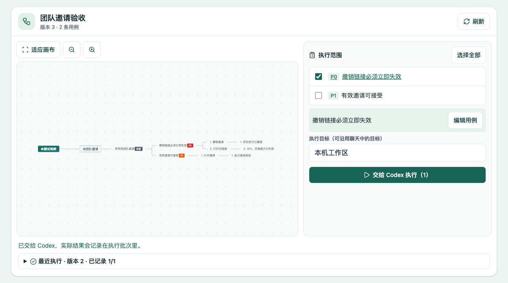
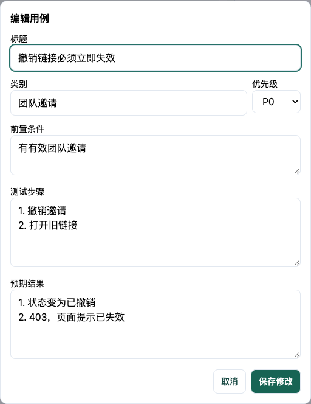

# next-ai-test-cases

把需求转成可手工执行的测试用例，直接在脑图中编辑，再导出 CSV 或 XMind。支持用对话增删用例、改名、调整优先级或修改步骤与预期。两种导出都读取当前脑图。桌面工作区分为历史对话、脑图和 AI 对话三栏，可拖动两侧分隔条调整宽度。历史和对话可独立折叠，展开按钮保留在对应窄栏的顶部。

手机和窄屏可在「脑图」「AI 对话」「历史」之间切换。脑图支持单指拖动、双指缩放，搜索入口在工具栏，导出与其他操作可从「更多脑图操作」打开。

## 选择版本

| 版本 | 启动方式 | 会话历史 | 资料与模型 |
| --- | --- | --- | --- |
| 单文件版 | 下载一个 HTML 文件，用浏览器打开 | 当前浏览器的 IndexedDB | 粘贴需求正文，从浏览器导入 Skill，直连允许跨域的模型网关 |
| 完整版 | 安装依赖后运行 `pnpm dev`，或构建后运行 `pnpm start` | SQLite | 支持 MCP 读文档、部署者安装的 Skill 和服务端模型配置 |

两版都支持 AI 生成和修改用例、手工编辑脑图、管理会话，以及导出 CSV 和 XMind。

### 单文件版

1. 从 [GitHub Releases](https://github.com/zx490336534/next-ai-test-cases/releases/latest) 下载 `next-ai-test-cases.html`，用新版 Chrome 或 Edge 打开。
2. 点「模型设置」，填写模型网关的 API Key。模型名和 Base URL 留空时分别使用 `gpt-4.1-mini` 和 `https://api.openai.com/v1`。点「测试连接」后保存。
3. 在 AI 对话里粘贴需求正文或业务规则。点「Skill」可导入 Markdown、ZIP、`.skill` 或包含多个 Skill 的文件夹。

页面和导出功能可以离线使用，AI 生成和修改需要联网访问模型网关。网关需通过 CORS 允许页面来源，以及 `Authorization` 和 `Content-Type` 请求头。本地文件的来源通常为 `null`，静态站点使用站点的 HTTPS 来源。连接本机回环网关时，浏览器可能会请求本机网络权限。本机网关拒绝跨域时，按下面的方式使用本机启动器。

历史和脑图保存在浏览器的 IndexedDB，和完整版的 SQLite 各自保存。清理浏览器数据会删除本地历史。浏览器可能按文件路径划分存储，更新文件时建议覆盖原路径并沿用同一浏览器配置。API Key 默认只在当前页面使用，可主动勾选记住。

在源码目录执行 `pnpm install --frozen-lockfile` 和 `pnpm build:html`，产物为 `dist/next-ai-test-cases.html`。也可以将该文件命名为 `index.html` 放到 GitHub Pages 等 HTTPS 静态站点。

#### 双击 HTML 连接智谱

在「模型设置」填入 Base URL `https://open.bigmodel.cn/api/v1`、模型名（例如 `glm-5.3`）和有标准 API 权限的智谱 Key。此地址自动使用智谱的 Responses 接口，可从本地 HTML 直连。标准 API 的额度与 Coding Plan 各自管理，Coding Plan 专用 Key 用于智谱支持的指定工具。 [智谱 Responses 文档](https://docs.bigmodel.cn/cn/guide/develop/responses/introduction) · [Key 类型说明](https://docs.bigmodel.cn/cn/coding-plan/notice/api-key-management)

#### 连接 Magpie 等本机网关

使用 Node.js 22.13 或更新版本。从 [Releases](https://github.com/zx490336534/next-ai-test-cases/releases/latest) 下载同一版本的 `next-ai-test-cases.html` 和 `serve-html.mjs`，放在同一目录后运行：

~~~bash
node serve-html.mjs --gateway http://127.0.0.1:3425
~~~

随后打开 [http://127.0.0.1:3025](http://127.0.0.1:3025)，在「模型设置」中输入 Magpie 的模型名、Base URL `http://127.0.0.1:3425` 和网关 Key，测试连接后保存。启动器仅监听回环地址，模型请求只转发到启动时指定的网关。网关地址不带路径时使用 `/v1`。端口冲突时可用 `--port` 指定其他端口。

启动器打开的仍是单文件版，历史保存在浏览器中。浏览器按来源保存数据，双击打开的文件与启动器地址各有自己的历史。在源码目录也可以先运行 `pnpm build:html`，再执行 `pnpm start:html --gateway http://127.0.0.1:3425`。

## 界面

| 三栏工作区 | 折叠两侧，只看脑图 |
| --- | --- |
|  |  |

| 脑图编辑与追问 | 会话历史 |
| --- | --- |
|  |  |

| 批量导入 Skill | 扩展执行记录 |
| --- | --- |
|  |  |

| 生成进度 | 模型设置 |
| --- | --- |
|  |  |

截图展示完整版，来自独立的演示环境，使用虚构的团队邀请需求、文档和 Skill。

## 完整版快速开始

需要 Node.js 22.13 或更新版本和 pnpm。

~~~bash
pnpm install --frozen-lockfile
pnpm dev
~~~

打开 [http://localhost:3000](http://localhost:3000)，点右上角「模型设置」，填写 API Key。模型名留空时使用服务端设定，服务端的默认模型是 `gpt-4.1-mini`。点「测试连接」发送一次简短请求，再点「保存」。

也可以复制配置模板，在本机填好默认值后启动：

~~~bash
cp .env.example .env.local
~~~

| 本地环境变量 | 用途 |
| --- | --- |
| `OPENAI_API_KEY` | 服务端默认密钥，留空时由用户在页面输入 |
| `OPENAI_MODEL` | 服务端默认模型 |
| `OPENAI_BASE_URL` | 服务端默认兼容网关地址，默认 `https://api.openai.com/v1` |
| `OPENAI_BASE_URL_ALLOWLIST` | 页面可填写的附加 HTTPS 网关，多个完整地址用逗号分隔 |

页面输入的 Key 默认在刷新时清除。勾选「在此浏览器记住设置和密钥」后，浏览器会跨会话保存此站点的配置。用「清除设置」移除已保存的配置。换 Base URL 会清空页面中的 Key，需为新网关填写自己的 Key。部署给多人使用时，给持有服务端默认 Key 和私有 MCP 的实例加访问控制。

### 本机兼容网关

如果要连接本机端口或填写自定义 HTTP(S) 网关，用回环模式启动：

~~~bash
pnpm dev:local
# 生产构建后的启动方式
pnpm build
pnpm start:local -p 3000
~~~

打开 [http://127.0.0.1:3000](http://127.0.0.1:3000) 后，在页面填入网关的 OpenAI 兼容 API 根地址，例如 `http://127.0.0.1:8080/v1`。该模式用于单机使用，通过回环地址监听。

## 会话历史

在右侧对话栏点「新建会话」可开始独立的对话和脑图。左侧历史支持打开、拖拽排序、重命名和确认删除，悬停标题可看全文。删除当前会话后会打开相邻会话，若无其他会话则新建空会话。消息和脑图会自动保存，刷新时恢复当前标签页最后打开的会话。

会话编辑后会立即显示「正在保存」。只要浏览器允许在当前标签页保存草稿，刷新会恢复尚未写入的修改。遇到其他标签页已保存的新版本时，会保留本页草稿供下载，避免覆盖另一页的修改。

会话排序和自定义名称也会保留。完整版的历史存放在 SQLite 文件 `.data/conversations.sqlite`，可用环境变量 `TEST_CASES_DB_PATH` 指定其他路径。应用按浏览器 Cookie 识别历史，清除站点 Cookie 或换用浏览器会使用新的历史空间。模型密钥、当前页的 MCP 和 Skill 选择由各自的设置流程管理。

## 用例、资料和导出

- 在 AI 对话输入需求正文，或先展开「需求示例」。「猜你想问」结合需求、刚生成或修改的用例给出具体追问，可选中节点查看相关建议。点击只会填入输入框，发送前仍可修改。
- 用例默认一次生成，处理中可以停止。对话里可以展开资料读取和结构校验的执行记录。每条 AI 回复还显示本轮耗时和模型报告的 Token 用量，有输入与输出明细时可悬停查看。
- 在画布中选择节点可编辑文字、添加同级或下级、移动和删除。支持查找节点、缩放、全屏、展开折叠和撤销重做。优先级可在标签上修改。
- 脑图按「类别 → 前置条件 → 用例 → 测试步骤 → 期望结果」组织。每条步骤各占一个节点，对应的期望结果作为它的子节点，两者都直接显示编号和正文。可执行用例才会计入生成结果。信息不足时在摘要里说明缺口。
- CSV 包含用例名、优先级、前置条件、步骤和预期。XMind 保留脑图层级，使用 `P0` 到 `P3` 对应的 `priority-1` 到 `priority-4` 标记。

### 完整版的 MCP 与 Skill

在对话输入框下方打开「MCP 与 Skill」。已启用的文字规范和资料会随生成或修改请求交给所选模型。导入和启用状态保留在当前页面，切换会话时仍可使用。

- **选择 MCP。** 页面会列出已挂载的服务。默认按链接来源自动匹配，也可勾选指定服务或停用全部。在本轮消息粘贴文档链接即可触发读取。对话执行记录会显示实际读取结果。
- **上传 Skill。** 选择 ZIP、`.skill`（ZIP 格式）或 Markdown。压缩包可以包含一个或多个 `SKILL.md`，支持外层目录和多 Skill。应用自动载入 Skill 正文、同级 Markdown/文本及 `references/` 中的文字资料。导入后可勾选启用、预览和移除。脚本、图片与其他二进制内容会跳过。服务端会在处理结束后清理上传的临时压缩包。
- **选择文件夹。** 可选单个解压后的 Skill 目录，也可选包含多个 Skill 的总目录。页面会递归识别 `SKILL.md`、ZIP 和 `.skill`，分别导入，重复内容会跳过，失败项会单独列出，其他项继续导入。可在列表里按项勾选，或使用「全选／全不选」一起调整已安装和已导入的 Skill。
- **选择已安装 Skill。** 在项目目录放入 `skills/<id>/SKILL.md`，可选文字资料放在同级或 `references/`，随后在页面勾选该 Skill。`skills/` 与 `mcp.json` 都由部署者在本地维护。

部署者可从 `mcp.json.example` 复制配置模板，并为每个服务填写 `documentTool`、`urlArgument`、`allowedOrigins`，以及可选的显示名 `name`。传输方式支持 `stdio`、Streamable HTTP 和 SSE。页面仅展示服务标识和名称，连接参数与凭据留在服务端。

原有的 `/api/test-case-agent`、`/plan`、`/module`、`/chat` 和 `/export-xmind` 入口继续可用。对话使用 `/api/test-case-agent/conversation` 的 AI SDK 消息流。会话历史和操作由 `/api/test-case-agent/sessions` 管理。

## Codex 插件

插件把测试用例、需求、项目上下文和每次执行的证据保存在同一个本地工作区。用例由会话中的 Codex 生成和执行。使用 Codex 已配置的模型，插件不需要单独的模型 Key。

### 安装

需要能运行本地插件的 Codex 和 Node.js 22.13 或更新版本。从 [GitHub Releases](https://github.com/zx490336534/next-ai-test-cases/releases/latest) 下载最新的 `codex-test-cases.zip`，解压并安装：

~~~bash
unzip codex-test-cases.zip -d codex-test-cases
codex plugin marketplace add ./codex-test-cases
codex plugin add test-case-workbench@next-ai-test-cases
~~~

该方式将插件安装到 Codex 的本地插件目录。因为插件使用本地 MCP 服务，进入 OpenAI 公共目录需要提交组织获批。 [桌面插件上架说明](https://developers.openai.com/plugins/deploy/desktop-only)

在 Codex 本地聊天里提及「测试用例工作区」插件，或调用 `$test-case-workbench`。在支持 MCP Apps 的桌面客户端中，点当前聊天右侧标签栏的「＋ → 插件和 MCP → 测试用例脑图」，选择要打开的工作区。侧边入口无需先让模型生成卡片。升级后如仍显示旧入口，重新打开 Codex 客户端并进入本地聊天。 [官方会话面板说明](https://developers.openai.com/plugins/build/extensions)

### 使用

- 生成。对 Codex 说「根据以下需求生成可手工执行的用例，保存并打开脑图」。可以同一轮提供测试仓库、测试环境、账号类型与已知限制。需求和这些上下文会随工作区保存。工作区不限制用例总数。用例较多时，可以通过 `append_cases` 分批保存到同一个工作区。
- 修改。可以对 Codex 说「把撤销邀请用例改成 P0，保留其余用例」，或在脑图中点击用例节点，也可从列表选择，随后打开「编辑用例」，保存后立即更新脑图。并行修改时按版本检查冲突。
- 执行。在卡片勾选用例，点「交给 Codex 执行」。可在卡片填写测试目标，也可沿用聊天已给出的目标。客户端无法代发时，卡片会给出可粘贴到聊天的指令。也可以在聊天直接指定用例和环境。Codex 以当前会话可用且获授权的工具执行，记录实际观察、通过、失败或阻塞，并显示最近批次。
- 续做。新会话可以从最近 50 个工作区中按标题恢复需求和用例。更早的工作区或执行批次可以凭对应 ID 打开。每个批次保存执行目标和选中用例当时的版本，后来编辑用例不会改写旧证据。

默认数据位置为 `~/.codex/test-case-workbench/library.sqlite`。Web 版的会话仍使用各自的存储。

### 脑图、编辑与执行记录

这些界面截图使用合成的团队邀请用例。

| 脑图与所选用例 |
| --- |
|  |

| 人工编辑用例 | 查看执行证据 |
| --- | --- |
|  |  |

### 从源码打包

安装依赖后执行 `pnpm build:codex`。生成 `dist/codex-test-cases.zip` 和已解包目录 `dist/codex-test-cases/`。也可把已解包目录直接传给 `codex plugin marketplace add`。安装包包含本地 MCP 服务与脑图资源，安装后无需启动 Next.js。

## 验证

~~~bash
pnpm lint
pnpm typecheck
pnpm test
pnpm build
pnpm build:html
pnpm build:codex
~~~
