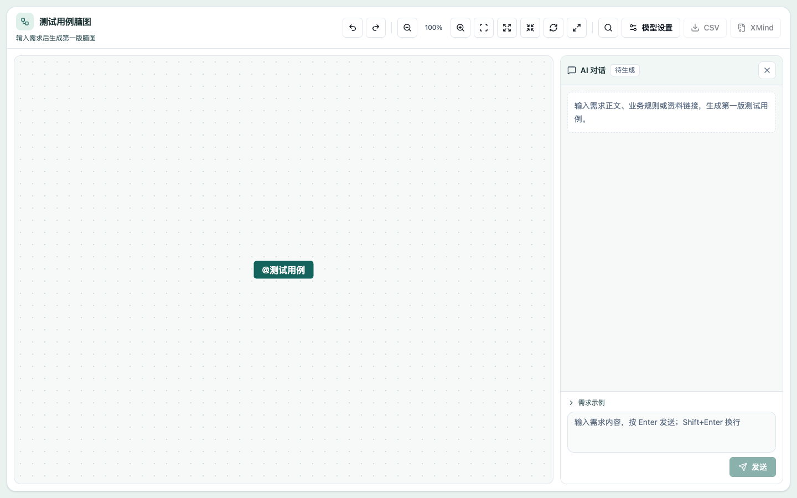
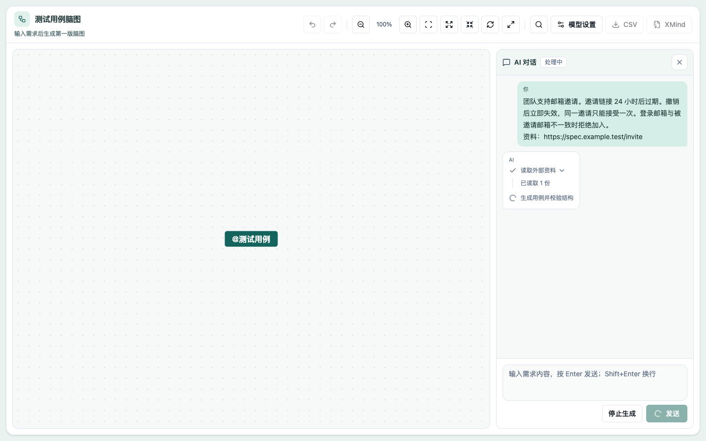
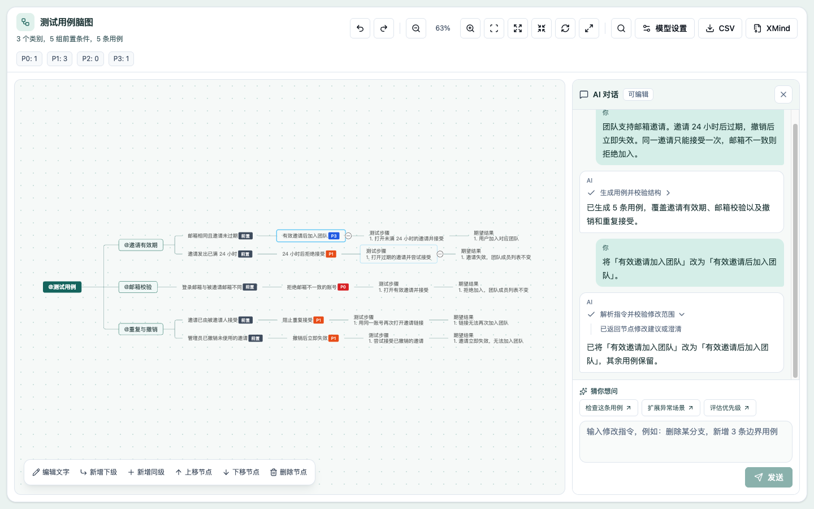
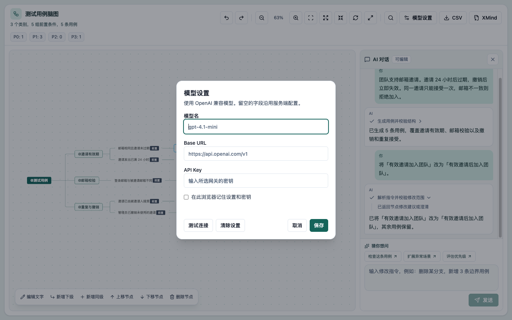

# next-ai-test-cases

把需求转成可手工执行的测试用例，直接在脑图中编辑，再导出 CSV 或 XMind。支持用对话增删用例、改名、调整优先级或修改步骤与预期。两种导出都读取当前脑图。桌面上脑图和对话并排，窄屏上下排列，可以收起对话扩大画布。

## 界面

| 工作区 | 生成中 |
| --- | --- |
|  |  |

| 编辑与导出 | 模型设置 |
| --- | --- |
|  |  |

截图使用同一份虚构的团队邀请需求和独立的演示网关。

## 快速开始

需要 Node.js 22.13 或更新版本和 pnpm。

~~~bash
pnpm install --frozen-lockfile
pnpm dev
~~~

打开 http://localhost:3000，点右上角「模型设置」，填写 API Key。模型名留空时使用服务端设定，服务端的默认模型是 `gpt-4.1-mini`。点「测试连接」发送一次简短请求，再点「保存」。

也可以复制配置模板，在本机填好默认值后启动：

~~~bash
cp .env.example .env.local
~~~

| 本地环境变量 | 用途 |
| --- | --- |
| `OPENAI_API_KEY` | 服务端默认密钥，留空时由用户在页面输入 |
| `OPENAI_MODEL` | 服务端默认模型 |
| `OPENAI_BASE_URL` | 服务端默认兼容网关地址，默认 `https://api.openai.com/v1` |
| `OPENAI_BASE_URL_ALLOWLIST` | 页面可填写的附加 HTTPS 网关，多个完整地址用逗号分隔 |

页面输入的 Key 默认在刷新时清除。勾选「在此浏览器记住设置和密钥」后，浏览器会跨会话保存此站点的配置。用「清除设置」移除已保存的配置。换 Base URL 会清空页面中的 Key，需为新网关填写自己的 Key。部署给多人使用时，给持有服务端默认 Key 和私有 MCP 的实例加访问控制。

### 本机兼容网关

如果要连接本机端口或填写自定义 HTTP(S) 网关，用回环模式启动：

~~~bash
pnpm dev:local
# 生产构建后的启动方式
pnpm build
pnpm start:local -p 3000
~~~

打开 http://127.0.0.1:3000 后，在页面填入网关的 OpenAI 兼容 API 根地址，例如 `http://127.0.0.1:8080/v1`。该模式用于单机使用，通过回环地址监听。

## 用例、资料和导出

- 在 AI 对话输入需求正文，或先展开「需求示例」。有脑图后，选择一个节点可查看与它相关的「猜你想问」，点击建议会填入输入框供修改。
- 用例默认一次生成，处理中可以停止。对话里可以展开资料读取和结构校验的执行记录。
- 在画布中选择节点可编辑文字、添加同级或下级、移动和删除。支持查找节点、缩放、全屏、展开折叠和撤销重做。优先级可在标签上修改。
- 脑图按「类别 → 前置条件 → 用例 → 测试步骤 → 期望结果」组织。步骤和预期逐项对应，可执行用例才会计入生成结果。信息不足时在摘要里说明缺口。
- CSV 包含用例名、优先级、前置条件、步骤和预期。XMind 保留脑图层级，使用 `P0` 到 `P3` 对应的 `priority-1` 到 `priority-4` 标记。

可选的 MCP 支持按需求正文中的 URL 读取资料。复制 `mcp.json.example` 到 `mcp.json` 后，为每个服务填写 `documentTool`（读取工具名）、`urlArgument`（该工具接收 URL 的字段）和 `allowedOrigins`（可读文档所在的精确来源）。支持 `stdio`、Streamable HTTP 和 SSE。旧配置需补齐这三个字段。结果会显示资料读取缺口。如果请求只提供了链接，请同时提供可读的资料或粘贴需求正文。

原有的 `/api/test-case-agent`、`/plan`、`/module`、`/chat` 和 `/export-xmind` 入口继续可用。对话使用 `/api/test-case-agent/conversation` 的 AI SDK 消息流。

## 验证与评测

~~~bash
pnpm lint
pnpm typecheck
pnpm test
pnpm build
~~~

[消融实验与复现命令](doc/refactor-evaluation.md) 包含冻结样本、覆盖评审、真实模型对照和最终流程选择。
